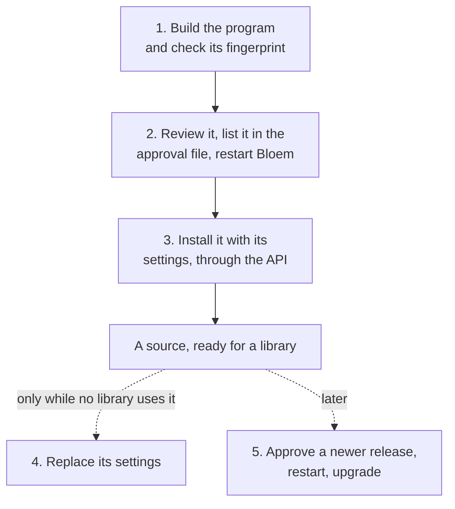

# Installing Bookwarehouse by hand

Most servers install Bookwarehouse from the plugin catalog, which needs no approval
(see [installing and connecting it](reference.md#installing-and-connecting-it)). This
page walks through the other way: building or downloading the program yourself,
approving it on the server, uploading it, changing its settings and upgrading it.

## When to install by hand

Install by hand when you need a release that is not in the plugin catalog, such as
your own build. Bloem Server runs an uploaded program only when it matches an entry
in the server's **approval file**: a protected file, written by the **operator** who
runs the server, that lists each reviewed release by its exact fingerprint. A program
can never approve itself, and no one can approve one through the API.



## The five steps

1. **Build and check.** The operator builds the program for the server's exact kind
   of machine, or downloads it, and checks that its fingerprint and its built-in
   description (its **manifest**) match the release files.
   [Details](#1-build-extract-and-review-the-executable).
2. **Approve.** The operator reviews the program, adds it to the approval file,
   points the server at that file and restarts the server. The server reads the file
   only when it starts. [Details](#2-supply-the-protected-host-approval-map).
3. **Install.** An administrator uploads the program together with the source's
   settings, through the API. This makes a **source**, but no library and no scan.
   The administrator then creates a library on the source.
   [Details](#3-inspect-support-and-install).
4. **Change settings.** An administrator can replace a source's whole settings, but
   only while no library uses it. [Details](#4-replace-configuration-through-the-native-route).
5. **Upgrade.** The operator approves the newer release and restarts the server;
   an administrator then uploads it onto the existing installation. The source, its
   settings and its library stay as they are.
   [Details](#5-upgrade-to-a-newer-release).

Good to know:

- The web admin's storage pages don't upload programs. They install and upgrade
  catalog releases, and connect a new ebook source; everything on this page goes
  through the API.
- An approval says only that the program may run. It doesn't show that the program
  works with your Bookwarehouse; check that by browsing and reading a book.
- Browsing below the `epub` and `pdf` folders also needs a Bookwarehouse that offers
  its folder list.

## Who can change what

| Who | What they can do here |
| --- | --- |
| The operator who installs the binary | Builds or downloads the program, reviews it, writes the approval file, sets `BLOEM_NATIVE_STORAGE_APPROVALS` and restarts the server. |
| Platform administrator | Installs, reconfigures, upgrades, disables and removes approved uploads for the platform, or for a chosen organization. |
| Organization administrator | The same for their own organization only, at a public `https` address on an allowed port, never with unencrypted HTTP. |
| Bookwarehouse's administrator | Issues the API key the settings carry. |
| Viewers | Nothing here. |

## Words used in the code

| On this page | In the code |
| --- | --- |
| Approval file | the JSON file named by `BLOEM_NATIVE_STORAGE_APPROVALS`, read by `nativestorage.LoadApprovals` in Bloem Server; the build's `native-storage-approvals.example.json` |
| An approval | one entry: artifact key → `{manifest, checksum, os, arch}` |
| Fingerprint | the executable's SHA-256, in `SHA256SUMS` and the manifest's `checksum` |
| Manifest | the output of `bloem-plugin-bookwarehouse manifest`, saved as `manifest.json` |
| Administrative context | the `access_token` from `POST /api/bloem/v2/admin/session` |
| Install, upgrade | `POST .../native-storage/installations` and `.../installations/{installation_id}/upgrade` |
| Replace settings | `PUT .../native-storage/sources/{source_key}/configuration` |
| Source key | the source's UUID, `source_key` |

## For developers

The plugin is built on the SDK v0.29.0
[storage-provider guide](https://github.com/Bloem-Studios/bloem-plugin-sdk/blob/v0.29.0/docs/storage-provider.md).
Bloem Server's
[native storage architecture](https://github.com/Bloem-Studios/bloem-server/blob/main/docs/architecture/bloem-native-storage.md)
describes the host side. The approval example has the shape the server's startup
loader reads: artifact key → `{manifest, checksum, os, arch}`.

The web admin (the Storage tab of the Plugins page, or an organization's Storage
sources page) calls the catalog routes, `POST .../catalog/installations` and
`.../catalog/installations/{installation_id}/upgrade`, with JSON bodies; it never
sends the multipart upload below. Its **Save connection** for a new ebook source calls
the configuration route in step 4. Bookwarehouse catalog releases need no entry in
the approval map and no restart.

### 1. Build, extract and review the executable

Build for the server's exact OS/architecture. On a matching Linux/amd64 machine:

```sh
make test
make build
cd dist/linux-amd64
sha256sum --check SHA256SUMS
./bloem-plugin-bookwarehouse manifest > manifest.check.json
cmp manifest.json manifest.check.json
rm manifest.check.json
```

On macOS use `shasum -a 256 -c SHA256SUMS`. These checks compare the artifact to its
extracted checksum and exact CLI output; they do not establish a trusted publisher on
their own.

The native upload uses the **raw executable**. Do not upload a ZIP or use the
ordinary plugin catalog, ordinary `/api/v2/admin/plugins/uploads` route, ordinary
plugin configuration routes or auto-update.

Packaging generates `native-storage-approvals.example.json`. It includes the full
extracted manifest and a key containing the release/platform and checksum prefix
(`bookwarehouse-0.4.0-<os>-<arch>-<first 12 hex digits>`). The record's `checksum` is
the full lowercase SHA-256. The operator may choose another opaque artifact key, but
the reviewed manifest, executable checksum, OS and architecture must remain an
immutable tuple.

**Generating this example does not approve executable code.** A host maintainer must
review the binary and metadata before adding it to the host approval map. The
manifest and installation request cannot approve themselves, and there is no
author-facing approval endpoint.

### 2. Supply the protected host approval map

Bloem Server reads `BLOEM_NATIVE_STORAGE_APPROVALS` at startup. Point it at the
reviewed JSON approval file, for example:

```text
BLOEM_NATIVE_STORAGE_APPROVALS=/etc/bloem/native-storage-approvals.json
```

The loader requires:

- An absolute, clean path with no symlink in any component.
- A regular file no larger than 1 MiB, owned by root or the server's effective UID,
  readable by the server, without write bits or group/other permissions. Mode `0400`
  is the usual choice.
- Parent directories owned by root or the server's effective UID, without
  group/other write permission; a root-owned sticky directory is the exception.

Provision the reviewed file using the deployment's server UID and protected directory
policy. A root-owned mode-0400 file is not readable by an unprivileged server, so
ownership must allow the actual server process to read it. In containers these checks
apply inside the container.

Set the variable in the server service/container environment and restart after
review. The approval map is fixed for the life of that server process. An unset
variable gives an empty map; an explicitly invalid path or approval record fails
startup. Adding or replacing a release requires a reviewed map and restart. A
standalone native video worker reads the same variable.

The server verifies the binary and embedded manifest again when it starts the
installed plugin. Approval does not establish backend conformance or successful
access to a real Bookwarehouse deployment.

### 3. Inspect support and install

Exchange your login session for an administrative context with
`POST /api/bloem/v2/admin/session`. Send `{"scope": "platform"}` for the platform, or
`{"scope": "organization", "organization_id": "<id>"}` for one organization; the
response holds an `access_token` and its `expires_at`. The caller must be a platform
administrator, or an administrator of that organization. A viewer token and an API
key without a login session are refused. The prefixes are:

- Organization: `/api/bloem/v2/admin/organization/native-storage`
- Platform: `/api/bloem/v2/admin/platform/native-storage`

Using the organization context as an example, with the `access_token` kept in
`BLOEM_NATIVE_ADMIN_TOKEN`:

```sh
NATIVE_URL='https://bloem.example/api/bloem/v2/admin/organization/native-storage'
curl --fail-with-body "$NATIVE_URL/capabilities" \
  -H "Authorization: Bearer $BLOEM_NATIVE_ADMIN_TOKEN"
curl --fail-with-body "$NATIVE_URL/artifacts" \
  -H "Authorization: Bearer $BLOEM_NATIVE_ADMIN_TOKEN"
```

Select the exact approved `artifact_key` returned by `GET /artifacts`. The list also
holds the verified catalog releases (`catalog: true`); the uploaded bytes must match
the selected artifact's checksum. An empty list means there is no selectable
approval.

Create a local mode-0600 `install-request.json` outside the repository, replacing the
artifact key and credentials locally:

```json
{
  "artifact_key": "COPY_THE_APPROVED_ARTIFACT_KEY",
  "provider_source_id": "bookwarehouse",
  "root_entry_id": "root",
  "enabled": true,
  "config": {
    "connection": {
      "base_url": "https://books.example",
      "api_key": "REPLACE_LOCALLY",
      "allow_insecure_http": false,
      "source_id": "bookwarehouse",
      "source_name": "Bookwarehouse",
      "max_book_bytes": 134217728,
      "max_cache_bytes": 536870912
    }
  }
}
```

`provider_source_id` must match the configured `source_id`. All five top-level fields
shown are required and non-null. The native `config` is a map from the configuration
key to its JSON object, whereas the RPC representation is a list of `ConfigEntry`
values. Empty `config: {}` is valid but leaves this provider unconfigured. For an
audiobook source, use `root_entry_id` `audio-root` and add `"content": "audiobooks"`
to the connection, with its own `source_id`.

A new source omits `source_key` and `expected_revision`. Organization-scoped requests
must omit `organization_id`, including null; platform requests may supply it. In
organization scope, `connection.base_url` must be an `https` URL on port 443, 7480,
8443, 9000 or 9443 whose host resolves only to public addresses, and
`allow_insecure_http` must be absent or false; otherwise the request fails with
`422 s3_endpoint_rejected`.

Send exactly the two multipart parts `request` and `binary`:

```sh
curl --fail-with-body "$NATIVE_URL/installations" \
  -H "Authorization: Bearer $BLOEM_NATIVE_ADMIN_TOKEN" \
  -F 'request=@install-request.json;type=application/json' \
  -F 'binary=@dist/linux-amd64/bloem-plugin-bookwarehouse;type=application/octet-stream'
```

Run this from the appropriate working directory or replace the file paths. The
request part is limited to 1 MiB, the nonempty binary to 256 MiB and the entire
multipart body to 258 MiB. Unknown/duplicate JSON fields, trailing JSON, extra
multipart parts and transfer-encoded parts are rejected. An artifact that is not
host-approved, uploaded bytes that do not match it, or a configuration that does not
satisfy the manifest's schema give `422 artifact_rejected`.

Success returns `201 {source: ...}`. It creates neither a library nor a scan. Create
the library through the ordinary new-library form, or with `POST /api/v2/libraries`
and `storage_source` set to the source key instead of `paths`; its first scan is
queued with it.

### 4. Replace configuration through the native route

Read `GET /sources/{source_key}` for its current `configuration_revision`, then
`PUT /sources/{source_key}/configuration` with a JSON body:

```json
{
  "expected_revision": 1,
  "config": {
    "connection": {
      "base_url": "https://books.example",
      "api_key": "REPLACE_LOCALLY"
    }
  }
}
```

Use the actual current revision. This replaces the **entire** configuration, with a
1 MiB body limit; omitted optional fields revert to provider defaults. The plugin
discards the previous configuration/cache generation. The source and its
installation must be enabled and attached, and the configuration must satisfy the
installed artifact's schema.

Any binding, discovered entry or retained reference prevents replacement with
`409 configuration_namespace_unverified`. A stale revision gives
`409 revision_conflict`; reload before retrying. Reconcile
`503 mutation_outcome_unknown` through source reads before attempting another
mutation. Native mutations have no blanket automatic replay rule.

Reattaching a retained `source_key` is restricted to verified lineage and an empty
retained namespace with a positive `expected_revision`; it is not general
reattachment support.

### 5. Upgrade to a newer release

Approve the new release in the host approval map, restart the host so it loads the
map, then send the same two multipart parts to
`POST /installations/{installation_id}/upgrade`. The `request` part holds
`artifact_key`, `source_key` and the source's current `expected_revision`. The upgrade
keeps the source, its encrypted configuration and its library; only the executable
changes and the plugin process restarts. It refuses an unapproved artifact or one of
another plugin.

A catalog release needs neither the map nor the restart:
`POST /catalog/installations/{installation_id}/upgrade` takes the same three fields as
a JSON body, and the web admin's **Upgrade** button uses it.

Preserve the existing approval entries when adding a release. Before upgrading,
record the source and installation identities, configuration revision, encrypted
configuration fingerprint, library bindings and enabled state; compare them
afterward. Verify the executable actually running, rather than only the upload
response.

For nested ebook browsing, deploy the companion Bookwarehouse
`GET /api/v1/books/folders` operation and book-list `folder` filter as well. Verify
both root browsing and navigation into a format directory. A root listing alone does
not contact that backend API and cannot establish support.

Related pages:

- [Bookwarehouse plugin reference](reference.md): how the plugin works, its settings
  and the build.
- [How the plugin is tested](validation.md).
- Bloem Server's
  [storage API](https://github.com/Bloem-Studios/bloem-server/blob/main/docs/bloem/api/storage.md):
  every native-storage route with its fields and error codes.
