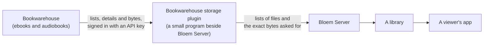
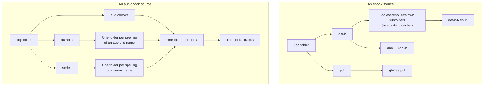
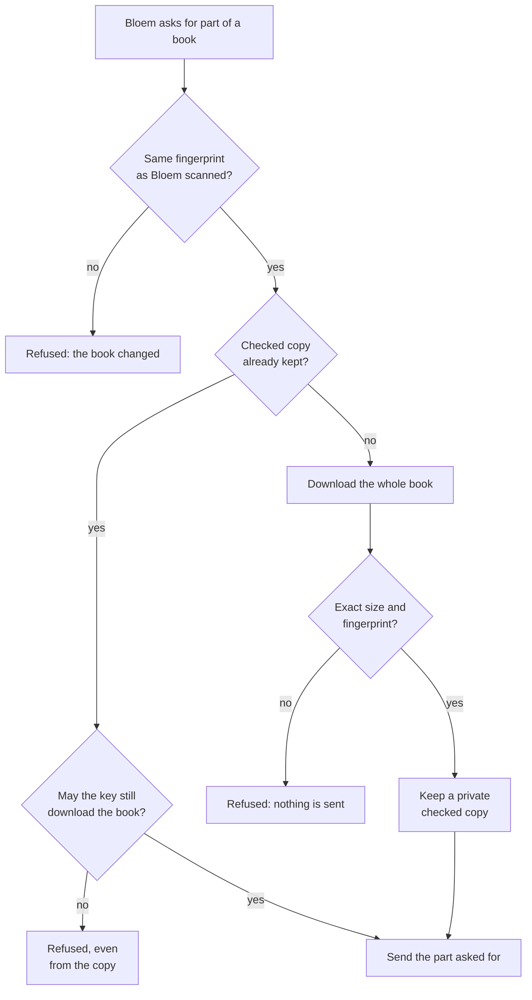
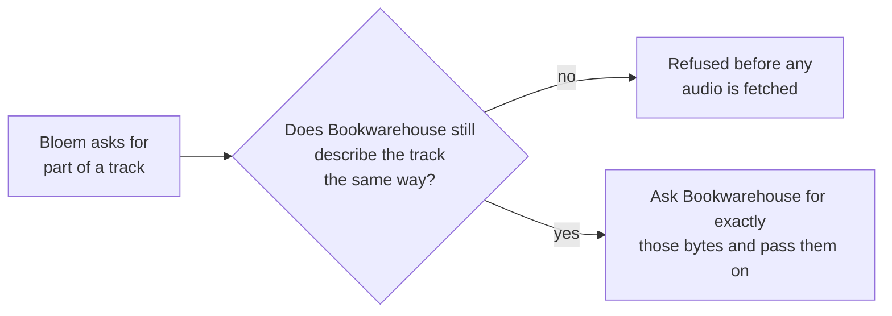
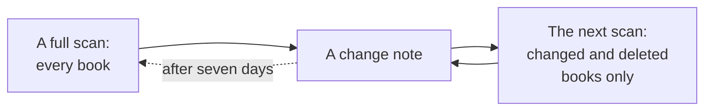
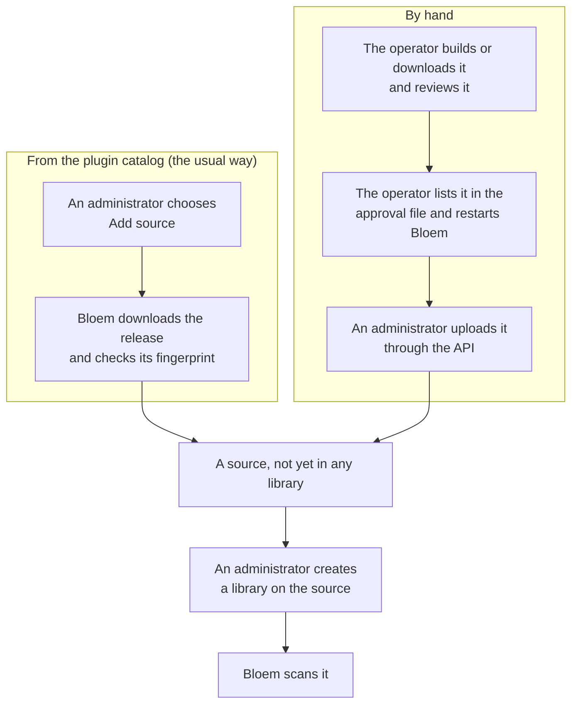
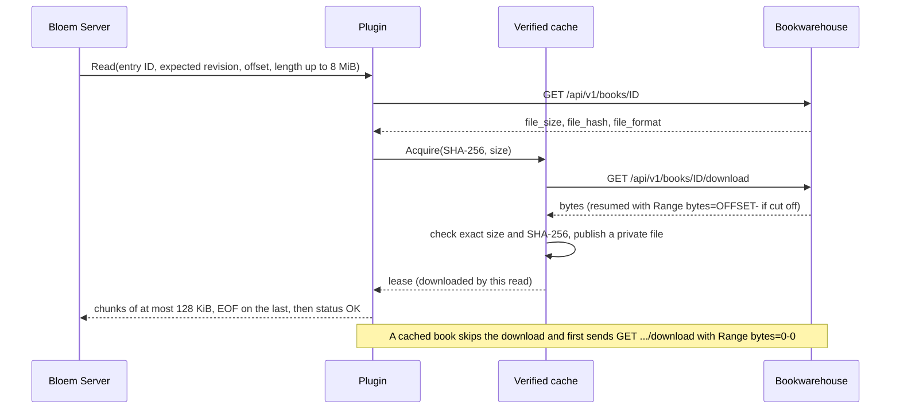

# Bookwarehouse plugin reference

This page describes how the Bookwarehouse plugin (`bloem.storage.bookwarehouse`,
version 0.4.0, built on the Bloem plugin SDK 0.29.0) works: what a library sees,
how books are read, how changes reach Bloem, how it is installed and set up, how it
orders requested books, and how it is built. The [README](../README.md) has the short
version. The technical rules are in the [For developers](#for-developers) section.

This page walks through what the plugin does, what a library sees of Bookwarehouse,
how an ebook is opened and an audiobook track is played, how changes reach Bloem,
how to install and connect the plugin, how it orders the books people request, and
how to build it yourself.

## What it is

**Bookwarehouse** is a separate book service. It keeps ebooks and audiobooks and
answers questions about them through its own API. This plugin lets a Bloem
**library** read straight from it.

The plugin is a **native storage provider**: a small program that Bloem Server starts
and talks to, and that knows one kind of storage. Bloem asks it for only two things:
lists of files, and the exact bytes it needs. Bloem never copies the whole
Bookwarehouse collection and never mounts it as a folder.



- Each installation of the plugin serves one **source**. A source holds either
  **ebooks** (EPUB and PDF files) or **audiobooks**, never both. To offer both, add
  two sources: one for ebooks and one for audiobooks.
- The plugin signs in to Bookwarehouse with an **API key**, a password made for
  programs. Bookwarehouse's own administrator issues it. The key must be allowed to
  read books, and for ebooks also to download them.
- Viewers read and listen as with any other title. These titles can't be
  downloaded for offline use, and Jellyfin and Audiobookshelf apps don't get them.
- Storage sources are **experimental** in Bloem: they work, but no storage service
  is certified yet.
- The same installation also **orders requested books** from Bookwarehouse: an ebook
  installation orders ebooks, an audiobook installation orders audiobooks. See
  [Ordering requested books](#ordering-requested-books).

## What a library sees

The plugin shows Bookwarehouse as folders. The plugin makes these folders up: they
are not folders on any disk, and they never point at one.



- An **ebook source** starts with two folders, `epub` and `pdf`. A book appears under
  its Bookwarehouse ID and type, such as `abc123.epub`. Its title, authors, cover and
  other details come with it, so Bloem can show the book without downloading it.
- Inside `epub` and `pdf`, the plugin can show Bookwarehouse's own **subfolders**,
  so a library can take just one shelf. This needs a Bookwarehouse that offers its
  folder list. An older Bookwarehouse still serves the two top folders and their
  books, but opening a subfolder fails. A folder with no books in it doesn't appear.
- An **audiobook source** starts with three folders: `audiobooks`, `authors` and
  `series`. Each book is a folder of its **tracks**, the audio files. An author or
  series folder lists that author's or series' books.
- When Bookwarehouse spells one author two ways, such as "A. B. Lindqvist" and
  "A.B. Lindqvist", each spelling gets its own folder, and both list the same books.
- A library can choose several of these folders, from both formats, beside ordinary
  folders on the server and other storage sources.

## Opening an ebook

Bookwarehouse can replace a book's file without warning, and it doesn't promise that
a download matches what it listed. So the plugin never passes on bytes it hasn't
checked.



1. Bloem asks for part of a book at the **revision** it scanned. An ebook's revision
   is its **fingerprint**, the SHA-256 hash Bookwarehouse lists for the file.
2. The plugin asks Bookwarehouse for the book's current details. If the fingerprint
   has changed, the read is refused.
3. If the plugin already keeps a checked copy, it first asks Bookwarehouse for a
   single byte of the download, to make sure the key may still download the book.
   If not, nothing is sent, not even from the copy.
4. Otherwise it downloads the **whole book**, even when only a small part was asked
   for, and checks its exact size and fingerprint. Only a book that matches is kept.
5. It sends the part asked for from the checked copy.

The checked copies live in the plugin's **verified download cache**, a private folder
in the server's temporary space. Two settings limit it: the largest book it will
download, and its total size. It also holds at most 128 books. When it is full, it
drops the copy that was used longest ago. It is emptied when the plugin stops or its
settings change, so after a restart each book is downloaded again on first use.

A large book can take longer to download than Bloem waits for one answer. The
download then carries on by itself, and Bloem asks again; the second request joins
the same download or finds the finished copy. Up to four books download at once. A
download that breaks off picks up where it stopped.

## Playing an audiobook track

Tracks are much larger than ebooks, so the plugin never downloads or keeps them.



1. Bloem asks for part of a track at the revision it scanned. A track's revision is
   a fingerprint of how Bookwarehouse **describes** the file: its size, where it is
   stored and Bookwarehouse's own sampled hash of it.
2. The plugin compares that with Bookwarehouse's current description. It may reuse a
   description it fetched in the last 30 seconds, because Bloem reads a book's
   tracks right after listing it.
3. It asks Bookwarehouse for exactly the bytes asked for and passes them on.

So a track's revision can't prove that every byte is unchanged: a file rewritten
with the same size and the same sampled parts keeps its revision.

The listing already gives each track's length, format and chapters, so Bloem adds an
audiobook to the catalog without opening its files.

## How Bloem keeps up with changes



1. A first scan of `epub`, `pdf` or `audiobooks` lists every book. At the end the
   plugin gives Bloem a **change note** (a change token).
2. The next scan hands it back. The plugin then lists only the books changed since,
   followed by the books Bookwarehouse reports as **deleted**. It looks ten minutes
   further back than it needs to, to catch late changes, so a book can be listed
   twice.
3. Seven days after the last full scan, the change note expires and Bloem lists
   everything again.

A full scan is not a snapshot: a book changed while the scan runs waits for the next
one. Only Bookwarehouse's list of deleted books tells Bloem at once that a book is
gone. A book that is simply no longer listed is marked missing after a second
complete scan also leaves it out (see
[when a file disappears](https://github.com/Bloem-Studios/bloem-server/blob/main/docs/architecture/bloem-native-storage.md#when-a-file-disappears)).

Subfolders inside `epub` and `pdf`, single audiobooks, authors and series are always
listed in full.

## Installing and connecting it

There are two ways to install the plugin. Most servers use the first.



### From the plugin catalog

The **plugin catalog** is Bloem's list of published plugin releases. Bloem Server
downloads a Bookwarehouse release from it and checks the release's fingerprint
itself, so no approval file and no restart are needed.

1. Open the storage sources. A **platform administrator** opens **Plugins** and the
   **Storage** tab. An **organization administrator** opens **Storage sources** in the
   organization's admin pages.
2. Choose **Add source**. The list shows the newest catalog release of each storage
   plugin.
3. For ebooks, choose **Install Bookwarehouse**. The new source appears in the list,
   not yet connected. Under it, fill in **Bookwarehouse server URL** and **API key**,
   then choose **Save connection**.
4. For audiobooks, choose **Audiobooks** under **Bookwarehouse audiobooks**, fill in
   **Bookwarehouse server URL** and **API key**, then choose **Install audiobooks**.
5. Choose **Test** on the source. It checks that the source can list its top folder.
6. Create a library and choose the source, or folders on it, as the library's
   location. Adding a source creates no library and starts no scan; the library's
   first scan starts when the library is created.

Good to know:

- The server URL is the address of Bookwarehouse, or of a proxy in front of it,
  such as `https://books.example/warehouse`. Don't add `/api/v1`: the plugin adds it.
- An organization administrator can only use an `https` address on the public
  internet, on port 443, 7480, 8443, 9000 or 9443.
- The web admin connects an ebook source only while it is not yet connected. To
  change a source's settings later, use the
  [configuration route](native-installation.md#4-replace-configuration-through-the-native-route).
  It works only while no library uses the source, so set the limits below before
  you create the library.
- To upgrade, choose **Upgrade** on the source and pick a newer catalog release. The
  source keeps its settings, its key and its library; only the program changes, and
  Bloem restarts it.

### By hand, with an approval

An **operator**, the person who runs the server, can build or download the program,
review it and list it in the server's **approval file**. This is the way to run a
release that is not in the catalog, such as your own build. It needs the API and a
restart; see [Installing Bookwarehouse by hand](native-installation.md).

### Settings

The plugin's settings are one group, called `connection`. The web admin fills in the
server URL and the API key, and the source ID and name; the API can set them all.

| Setting | What it does | Default |
| --- | --- | --- |
| Content (`content`) | `ebooks` or `audiobooks`. Never change it on a source that already has books. | `ebooks` |
| Server URL (`base_url`) | Bookwarehouse's `https` address, or a proxy address with a path. | none |
| API key (`api_key`) | Bookwarehouse's key for this source. Ebooks need permission to read and to download books; audiobooks need permission to read them. Ebook requests use it too. | none |
| Request API key (`request_api_key`) | A Bookwarehouse key with the **Curator** role, for audiobook requests: adding a torrent needs it. Empty means the API key above, which then needs that role. | none |
| Requested ebook format (`preferred_format`) | `epub` or `pdf`: the format ebook requests ask Bookwarehouse for. | `epub` |
| Allow unencrypted HTTP (`allow_insecure_http`) | Lets the plugin use plain `http`, for a trusted test network only: the key then travels unprotected. Bloem refuses it from an organization administrator. | off |
| Source ID (`source_id`) | The source's lasting name inside the plugin. | `bookwarehouse`, or `bookwarehouse-audiobooks` for audiobooks |
| Source name (`source_name`) | The name shown for the source. | `Bookwarehouse`, or `Bookwarehouse audiobooks` for audiobooks |
| Largest book (`max_book_bytes`) | The largest ebook the cache will download and check. | 128 MiB |
| Cache size (`max_cache_bytes`) | The disk space the cache may use. At least the largest book. | 512 MiB |

The two size limits apply to ebooks only. Audiobook tracks are read straight from
Bookwarehouse and never cached.

If the server URL or the API key is missing, the source stays **not connected**:
it installs, but every list or read fails until both are set.

Upgrading from 0.3.x needs no settings change: the two request settings are
optional, and adding them doesn't change the source's file identities.

## Ordering requested books

When a viewer asks for a book the library doesn't have, Bloem can hand the request
to this plugin. The installation orders it from the same Bookwarehouse, with the
same address and key, and reports how the order is going until the book arrives.
Bloem still decides who may ask, approves requests and decides when one is done.

- **Ebooks.** An installation whose content is `ebooks` orders by ISBN through
  Bookwarehouse's monitoring (`POST /monitoring/add`), after checking that
  Bookwarehouse has neither the book nor an order for it. A request is done when
  the ebook shows up in the linked library. This is the ordering that the separate
  Bookwarehouse ebook requests plugin (`bloem.requests.bookwarehouse`) used to do,
  unchanged.
- **Audiobooks.** An installation whose content is `audiobooks` searches
  AudiobookBay through Bookwarehouse, picks the best release by itself and has
  Bookwarehouse download and import it with its own torrent client. It picks only a
  release whose title and author match, prefers M4B to MP3 and more seeders, and
  skips samples, collections and odd sizes. If nothing matches well enough, it says
  no release was found and tries again on Bloem's next search pass. Adding a torrent
  needs a key with Bookwarehouse's **Curator** role; set it as the request API key.
- An installation refuses the other kind of request with a plain message.

To set it up, add a request connection in Bloem's admin on the plugin's **ebooks**
or **audiobooks** request capability, bound to the matching installation, and link
the library that reads from this source. **Test connection** checks the key: for
audiobooks, it says plainly when the key lacks the Curator role.

## Building it yourself

An operator who installs by hand builds the program from this repository:

1. Install Go 1.26 or newer (`go.mod` sets `go 1.26.0`; CI and `scripts/build.sh` use Go
   1.27.4), and Python 3.8 or newer for the release files.
2. Run the tests and build for the machine you are on:

   ```sh
   export GOTOOLCHAIN=local GOWORK=off GOMAXPROCS=2
   make test
   make test-race
   make build
   ```

   To use a specific Go toolchain:

   ```sh
   make test GO=/path/to/go/bin/go
   make build GO=/path/to/go/bin/go
   ```

3. On Linux/amd64 the result is four files:

   ```text
   dist/linux-amd64/bloem-plugin-bookwarehouse
   dist/linux-amd64/manifest.json
   dist/linux-amd64/SHA256SUMS
   dist/linux-amd64/native-storage-approvals.example.json
   ```

4. For other machines, `make release` builds Linux/amd64, Linux/arm64 and
   macOS/arm64. Only the build for the machine you are on gets its release files.
   Copy each other program and `scripts/package.py` to a machine of its own kind, and
   make its release files there:

   ```sh
   python3 scripts/package.py dist/linux-arm64/bloem-plugin-bookwarehouse linux arm64
   python3 scripts/package.py dist/darwin-arm64/bloem-plugin-bookwarehouse darwin arm64
   ```

A program built on another kind of machine is not, on its own, ready to approve. The
same source, Go version, dependencies and target build the same bytes every time.
See [how the plugin is tested](validation.md) for what the tests prove, and
[Installing Bookwarehouse by hand](native-installation.md) for the review and
approval steps.

## Example: a book club's server

This example is made up.

Northside Readers, a book club, runs Bloem with its books in Bookwarehouse at
`https://books.example`. Most of its ebooks are small EPUBs, but it also has a few
illustrated PDFs of up to 300 MiB, and a shelf of audiobooks.

- **The large PDFs.** With the default settings, a 300 MiB PDF is larger than the
  128 MiB largest-book limit. Opening it fails, and no bytes are sent.
- **Setting the limits first.** A source's settings can only be replaced while no
  library uses it. So before creating the library, the club's administrator sets
  the largest book to 384 MiB and the cache size to 1 GiB, through the configuration
  route.
- **What the cache holds.** The cache now keeps three of the largest PDFs at once,
  plus small books, up to 128 in all. When a member opens a fourth large PDF, the
  copy used longest ago is dropped to make room. The first opening of a large PDF
  downloads all 300 MiB before its first page shows.
- **The audiobooks.** The club adds a second source with **Audiobooks**. Its size
  limits don't matter: tracks are read straight from Bookwarehouse.
- **A revoked key.** When Bookwarehouse's administrator takes away the key's
  download permission, the next read of any ebook fails, even of a book in the
  cache.

## Who can change what

| Who | What they can do here |
| --- | --- |
| The operator who installs the binary | Builds or downloads a release by hand, reviews it, lists it in the approval file (`BLOEM_NATIVE_STORAGE_APPROVALS`) and restarts the server. Catalog releases don't need this. |
| Platform administrator | Adds, connects, tests, upgrades, disables and removes the platform's Bookwarehouse sources, from the catalog or an approved upload. May switch on unencrypted HTTP. |
| Organization administrator | The same for their own organization's sources, but only at a public `https` address on an allowed port, and never with unencrypted HTTP. |
| Bookwarehouse's administrator | Issues the API keys and decides what they may read, download and order. Taking away download permission stops ebook reads at once, even from the cache. Audiobook requests need a Curator key. |
| Viewers | Nothing here. They read and listen to what their profile may see. |

## Words used in the code

| On this page | In the code |
| --- | --- |
| The plugin | plugin ID `bloem.storage.bookwarehouse`; the program `cmd/bloem-plugin-bookwarehouse`; its manifest `cmd/bloem-plugin-bookwarehouse/manifest.json` |
| Native storage provider | the SDK's `bloem.plugin.v1.StorageProvider` service: `Describe`, `List`, `Stat`, `Read` |
| Settings | the `connection` configuration entry, decoded into `provider.Config` (`internal/provider/config.go`) |
| Source | the one `Source` that `Describe` returns, named by `source_id`; in Bloem Server, a `bloem_storage_sources` row |
| Folder | a directory entry: `root`, `epub`, `pdf`, `folders/<format>/<base64url path>`; for audiobooks `audio-root`, `audiobooks`, `authors`, `series` |
| Revision, fingerprint | `Entry.revision`: `sha256:<hex>` for an ebook, `bwaudio-v1:<hex>` for a track, `cover:v2:<hex>` for a cover |
| Verified download cache | `internal/verifiedcache` |
| Talking to Bookwarehouse | `internal/bookwarehouse` |
| Listing, reading, covers | `internal/provider` (`list.go`, `provider.go`, `folders.go`, `audio.go`, `cover.go`) |
| Change note | `change_token` in a `List` reply, sent back as `changes_since` |
| Deleted books | `removed_entry_ids` |
| Not connected | the provider's state is `nil`; calls return `FailedPrecondition` |
| Approval file | the file named by `BLOEM_NATIVE_STORAGE_APPROVALS`; the build writes `native-storage-approvals.example.json` |
| Plugin catalog | `plugins.json` in the `Bloem-Studios/bloem-plugins` repository, read by Bloem Server's `internal/plugins/bloem_storage_catalog.go` |
| Building | `Makefile`, `scripts/build.sh`, `scripts/package.py` |
| Ordering requested books | the `request_router.v1` capabilities `ebooks` and `audiobooks`, served by `internal/requests` |
| Release choice | `requests.Choose` (`internal/requests/selection.go`) |

## For developers

A standalone Go plugin that serves Bookwarehouse EPUB/PDF books and audiobook tracks
through the Bloem SDK v0.29.0 native `StorageProvider` service, and orders requested
books through `request_router.v1`. Its identity is `bloem.storage.bookwarehouse`,
version `0.4.0`, with `silo_api_version` `v1` and supported platforms linux/amd64,
linux/arm64 and darwin/arm64. Its only public capabilities are the two request
routers (see [Request router](#request-router)); it has no packaged assets, HTTP
routes, or host broker dependency. `cmd/bloem-plugin-bookwarehouse/main.go` serves
the embedded manifest with `sdkruntime.ServeManifestWithOptions`,
`CapabilityServers{RequestRouter: ...}`, `WithStorageProvider` and `WithConfigure`.

The adapter targets the Bookwarehouse API as described in
[Bookwarehouse API use](#bookwarehouse-api-use). Automated
verification uses local HTTP fixtures and an actual plugin process; the tests never
reach a live Bookwarehouse. Building the artifact neither approves it on a host nor
establishes backend acceptance.

### Build and verify

Use Go 1.26 or newer and Python 3.8 or newer for release metadata extraction. The
commands are in [Building it yourself](#building-it-yourself). The `Makefile`
exports `GOTOOLCHAIN=local`, `GOWORK=off` and `GOMAXPROCS=2`; `make test` runs
`go test -mod=readonly -p 2 ./...`, and `make test-race` runs it with `-race`,
`CGO_ENABLED=1` and `BOOKWAREHOUSE_TEST_RACE=1`. CI (`.github/workflows/ci.yml`) runs
`make test-race`, `GOWORK=off go vet ./...` and `make build` with Go 1.27.4.

`make build` (`scripts/build.sh`) builds the native platform with CGO disabled,
trimmed paths, disabled VCS stamping and fixed version/linker settings:
`-mod=readonly -trimpath -buildvcs=false -p 2` and
`-ldflags="-s -w -buildid= -X main.version=0.4.0"`, with `GOENV=off`, an empty
`GOFLAGS`, `GOAMD64=v1`, `GOARM64=v8.0`, an empty `GOEXPERIMENT` and `LC_ALL=C`. It
deletes a target's old `manifest.json`, `SHA256SUMS` and approval example before
building, so old metadata never accompanies a new binary. Unsupported targets exit
with status 2.

The executable's `manifest` command supplies the exact manifest; packaging checks its
checksum against the actual executable SHA-256. The embedded source manifest retains
`"checksum": "__CHECKSUM__"`. The SDK's extracted protobuf
JSON uses camelCase keys and may omit empty arrays. Do not rewrite or substitute the
embedded source manifest for the extracted one.

`scripts/package.py` runs only on the executable's native OS/architecture. It
requires a regular executable that is not a symlink, refuses a manifest whose
checksum, `pluginId`, `version`, `siloApiVersion` (`v1`) or supported platforms do
not match, refuses capabilities other than `request_router.v1` `ebooks` and
`audiobooks`, refuses any `httpRoutes` or `assets`, and refuses an
executable that changed during extraction. It writes the extracted `manifest.json`
byte for byte, `SHA256SUMS`, and `native-storage-approvals.example.json` with the key
`bookwarehouse-0.4.0-<os>-<arch>-<first 12 hex digits of the SHA-256>`.

`make release` cross-compiles Linux/amd64, Linux/arm64 and macOS/arm64. Only a target
matching the build machine gets extracted metadata automatically; run extraction on
each other target's native OS/architecture with the `scripts/package.py` commands
above. Each command belongs on its corresponding machine. Copy the executable and
script there first. A cross-built binary alone is not a complete approval package.
Builds are intended to reproduce byte-for-byte from the same source, Go toolchain,
dependencies and target; release scripts clear ambient Go build flags and do not
embed timestamps. See [validation](validation.md) for the test boundary and
[native installation](native-installation.md) for the operator-reviewed approval
workflow.

### Connection configuration

The native host calls `Runtime.Configure` with one entry whose key is `connection`
and whose protobuf Struct value is this JSON object:

```json
{
  "base_url": "https://books.example",
  "api_key": "REPLACE_LOCALLY",
  "allow_insecure_http": false,
  "source_id": "bookwarehouse",
  "source_name": "Bookwarehouse",
  "max_book_bytes": 134217728,
  "max_cache_bytes": 536870912
}
```

| Setting | Meaning and default |
| --- | --- |
| `content` | Defaults to `ebooks`; `audiobooks` selects a distinct audiobook source. Do not change the feed of a populated source. |
| `base_url` | HTTPS origin or reverse-proxy prefix, such as `https://books.example/warehouse`. Do not append `/api/v1`; the client appends it. |
| `api_key` | API key sent as `X-API-Key`. Ebooks need book-read and book-download authority; audiobook streaming needs book-read authority. |
| `allow_insecure_http` | Defaults to `false`. Explicit opt-in permits HTTP for a trusted local/test network; HTTP sends the key without transport encryption. |
| `source_id` | Defaults to `bookwarehouse` for ebooks or `bookwarehouse-audiobooks` for audio; stable source identity, 1–128 ASCII letters, digits, underscores or hyphens. Match this in the installation request. |
| `source_name` | Defaults to `Bookwarehouse` for ebooks or `Bookwarehouse audiobooks` for audio; display name, at most 256 bytes with no control characters. |
| `max_book_bytes` | Defaults to 128 MiB (134217728 bytes). Largest whole book that can be verified. |
| `max_cache_bytes` | Defaults to 512 MiB (536870912 bytes). Cache byte budget, including reserved downloads; must be at least `max_book_bytes`. |
| `request_api_key` | Optional, secret. Key for audiobook requests, which need Bookwarehouse's Curator role (`books.create`); empty means `api_key`. |
| `preferred_format` | Optional, `epub` or `pdf`; the ebook request format when the request connection names none. Empty means `epub`. Any other value is `InvalidArgument`. |

An omitted or zero byte limit selects its default. Hard ceilings are 8 GiB per book
and 32 GiB per cache. Oversized books or unavailable capacity fail without partial
output. Each `Read` request is limited to 8 MiB, independent of the whole-book
download limit. The manifest's JSON schema declares the same fields with
`additionalProperties: false`, the `source_id` pattern, `source_name` `maxLength`
256 and the byte ceilings; Bloem Server checks a configuration against that schema
before it stores it.

`request_api_key` and `preferred_format` are left out of the key that signs entry
tokens and cursors, so setting them on an existing source changes no identity.
Configuration does no backend network I/O. Empty or incomplete settings leave the
provider unconfigured: storage calls return `FailedPrecondition`. So do a missing
`base_url` or `api_key`, a URL or key the client rejects (see
[Bookwarehouse API use](#bookwarehouse-api-use)), a `source_id` or `source_name`
outside its bounds, a negative byte limit, limits above the ceilings, and
`max_cache_bytes` below `max_book_bytes`. Malformed configuration envelopes/types are
rejected with `InvalidArgument`: more than one entry, a key other than `connection`,
a missing value, unknown fields, wrongly typed fields, or a `content` other than
`ebooks` or `audiobooks`. A private cache directory that cannot be created fails
`Configure` with `Unavailable`. Replacing configuration cancels work using the old
generation and starts an independent cache; it does not inherit credentials or
cached files from the previous generation.

The manifest marks `api_key` as a secret password field. This is an admin-form hint,
not encryption inside the plugin: authorized configuration arrives in plaintext in
the process. The native host encrypts stored configuration and omits secret
configuration from responses. Keep real credentials out of source, manifests, release
metadata, shell history and logs. Use a protected local request file for
installation. The provider does not use inherited credential environment variables
or a RuntimeHost broker.

Releases up to 0.3.9 show an admin-form hint for `content` saying audiobooks need
explicit audio-sized cache limits. That predates 0.3.4: tracks are no longer
downloaded or cached, so the limits apply to ebooks only (see
[Audiobook source](#audiobook-source)). 0.3.10 carries the corrected hint and changes
nothing else.

### File identities and immutable reads

`Describe` exposes one source, protocol revision 1, with root entry `root`, the
configured `source_name`, `revision_pinned_reads`, `media_kinds` set to the
configured `content` and directory-only listing. The virtual root contains `epub` and
`pdf`; all three directories have revision `directories-v1`. For book ID `abc123`, an
EPUB has entry ID `epub/abc123`, logical path `epub/abc123.epub` and revision
`sha256:<64 lowercase hex digits>`. PDFs use the corresponding `pdf/` prefix and
`.pdf` suffix. These are virtual identities and display paths, not local or backend
filesystem paths. Names never use backend paths or mutable titles. Book IDs are 1–128
ASCII letters, digits, underscores or hyphens. File `Stat` and `Read` require the
expected revision obtained from listing (`InvalidArgument` without one,
`FailedPrecondition` when it differs). Directory `Stat` accepts an omitted expected
revision for host browsing; a supplied directory revision must still match.

#### Nested ebook folders

Directory-only browsing under `epub` or `pdf` uses the read-only
`GET /api/v1/books/folders` endpoint to expose the actual nested directories in
Bookwarehouse's relative catalog storage keys. The endpoint and the optional `folder`
filter on `GET /api/v1/books` must be present in Bookwarehouse. Older backends
continue to support the existing flat scans and reads, but deeper browsing requires
that API addition; a missing endpoint fails the browse. Empty directories without
cataloged books have no API representation. A root listing never calls this
endpoint.

Nested directories use entry IDs `folders/<format>/<base64url-relative-path>`
(unpadded, canonical). These are validated API selectors, never local paths. Their
names and logical paths (`<format>/<relative path>`) are display data. Relative
directory paths are limited to 756 UTF-8 bytes with at most 255 bytes per segment,
keeping identities within the host's 1024-byte limit; empty, `.` and `..` segments,
backslashes, NUL and control characters are rejected. Directory browsing has its own
signed, scoped cursors and returns no file entries or change tokens. A library may
retain several selected directories, including directories from both formats,
alongside local filesystem and other supported storage locations; the plugin imposes
no two-directory limit. A browse page holds at most 512 directories, fewer for deep
paths so the reply stays under the host's 1 MiB bound.

Scanning a selected nested directory uses a slash-boundary descendant filter,
confirms each returned row belongs to that scope, and retains the original
`<format>/<book-id>` file identities, display paths and SHA-256 revisions. Nested
scopes use full inventories so books moved out of a directory can be reconciled; a
change token on one is refused with `FailedPrecondition`. `Stat` of a nested
directory checks that Bookwarehouse still reports it. Ordinary EPUB/PDF scans and
their incremental tokens retain their existing behavior. Backend storage keys never
become download URLs or file handles.

#### Whole-book verification

Bookwarehouse serves its current object and does not enforce an immutable revision on
downloads. The plugin therefore downloads the **entire book** on a cache miss, checks
the exact declared size and SHA-256, and only then publishes a private immutable
local file. Even a small first range requires whole-book verification. A failed or
changed download exposes no unverified bytes.



The download belongs to the cache, not to the `Read` that started it. Bloem Server
bounds each storage RPC (10 seconds by default), so a `Read` that is still waiting
shortly before its deadline (500 ms, or a quarter of the remaining time when that is
less) answers `Unavailable` while the download carries on; a retried or concurrent
`Read` of the same book joins it, and a later one finds the verified file. Up to four
books download at once. When a transfer breaks off, for example at Bookwarehouse's
server write timeout, the plugin resumes it with a single `Range: bytes=<offset>-`
request from the bytes already written and hashed; a server that answers `200`
instead restarts the download. Resuming never weakens verification: the whole object
must still match the pinned size and SHA-256, so an object replaced between requests
is rejected. A download gives up after 30 minutes, after four consecutive requests
that deliver nothing (waiting 500 ms, then 1 s, then 2 s between them), or on a
denial, a missing book or a size mismatch. A request that delivers no bytes for a
minute is abandoned and resumed. A body that keeps ending cleanly before the declared
size is a shorter object and fails as a mismatch; a `416` to a resume means the
object is no longer than the bytes already verified, which is also a mismatch.

Each read checks current metadata and download authority. On a cache hit the plugin
asks `GET /download` for one byte (`Range: bytes=0-0`) and accepts `206`, `416` for
an empty book, or a `200` from a server that ignores ranges (closed unread); the
requested range comes from the previously verified local file. A read whose own
download produced the file skips the probe. Revoked download permission prevents
access to a warm cache, even when metadata remains readable. Changed metadata fails
the old pinned revision; the cache is not an archive of available historical
versions.

Reads stream consecutive absolute offsets in chunks no larger than 128 KiB. The final
chunk marks EOF, and successful completion also requires final gRPC status OK. A
zero-length read sends one empty EOF chunk. A caller must discard a failed read even
if bytes arrived before an error or cancellation.

#### The verified cache

The cache is ephemeral, local to one process/configuration, and bounded by both the
byte budget and a fixed maximum of 128 retained plus in-flight entries. It uses a
private mode-0700 temporary directory (`bookwarehouse-verified-*`) and mode-0600
files, evicts the least recently used unpinned entries under pressure, and releases
resources on orderly closure. A book over `max_book_bytes` fails with
`ResourceExhausted` before any download. A book that needs room while every entry is
pinned by an open read, or a fifth concurrent download, waits for room or a download
slot until its read's deadline, which then answers `Unavailable`. Two books with the
same SHA-256 share one file. It does not persist across restarts or
provide shared/distributed storage. Process crashes or forced termination can leave
temporary files; use a host-managed private temporary directory with an appropriate
lifecycle and disk quota. Configuration replacement can briefly overlap an old
in-flight lease and a new cache budget: existing leases stay readable until released,
and the last release removes the old files and directory.

### Audiobook source

Use a separate configured source with `content=audiobooks`. Ebook defaults, entry
IDs, revisions and tokens remain unchanged. Audio uses `audio-root`, so reusing an
ebook source ID cannot hide a changed content boundary. The plugin rejects changing a
previously configured source ID's feed in the same process (`FailedPrecondition`);
the host enforces the persisted boundary for populated sources across restarts.

Tracks are read straight from Bookwarehouse, so `max_book_bytes` and
`max_cache_bytes` do not limit them; they still bound the ebook download cache.

```json
{
  "base_url": "https://books.example",
  "api_key": "REPLACE_LOCALLY",
  "content": "audiobooks",
  "source_id": "bookwarehouse-audiobooks",
  "source_name": "Bookwarehouse audiobooks"
}
```

`Describe` declares `media_kinds=["audiobooks"]` and directory-only listing. The root
contains `audiobooks`, `authors` and `series`; audio directories have revision
`audio-directories-v1`. Books keep the directory ID `audiobooks/<provider book ID>`
across collection names and aliases; a book's directory is named after its title, or
its ID when it has none.

`authors` and `series` list Bookwarehouse's rows as they come: one per spelling,
ordered by the spelling's exact bytes. Each spelling is its own directory,
`authors/<base64url ID>.<spelling tag>`, where the tag is the first 8 bytes of the
spelling's SHA-256 in hex; provider IDs are bounded to 749 UTF-8 bytes (letters,
digits, marks and hyphens) and spellings to 1 KiB so the identity and continuation
fit their host limits. Spellings that share an ID, such as `A. B. Lindqvist` and
`A.B. Lindqvist`, are separate directories that list the same books. That keeps
directory IDs unique without reading every row first, so a listing reads only the
provider pages it returns, at any catalog size. A continuation resumes after the last
listed spelling: rows added or removed before it neither repeat nor skip one.

Listing or checking one collection directory asks Bookwarehouse for that ID alone
(`GET /api/v1/audiobooks/authors/<id>` or `/series/<id>`, at most 256 spellings) and
requires the directory's spelling to be among the returned names; an absent ID or
spelling is `NotFound`. The books come from the exact `author_id` or `series_id`
filter, which includes every spelling.

`directories_only=true` returns directories without audio stream requests, verified
snapshots, change tokens or removals. Browsing a leaf book returns an empty terminal
page. Continuations are bound to content/configuration, directory and browsing
intent. Listing a selected book returns its tracks, ordered by disc number, track
number and retained file ID, from one Bookwarehouse request and without opening any
of them. A continuation fails with `FailedPrecondition` if the book's tracks changed
between pages.

The `audiobooks` directory issues change tokens like the ebook formats: a listing
from a token returns the books updated since it (with a ten-minute overlap), then the
books Bookwarehouse's audiobook deletion feed reports, as removed `audiobooks/<ID>`
entries. Tokens expire seven days after the full listing that started them. Books,
collections and browsing are always listed in full and refuse a token with
`FailedPrecondition`. Audio tokens name the feed `audiobooks-2` since 0.3.9, when a
listed book began to carry a one-file book's embedded chapters; a token naming an
earlier feed is refused, so the host lists every book in full once.

A track keeps ID `audio/<provider book ID>/<provider file ID>`, name
`<file ID>.<container>` and logical path `audiobooks/<book ID>/<file ID>.<container>`.
The container comes from the stored file's extension and must be one of `m4b`,
`mp3`, `m4a`, `aac`, `flac`, `ogg`, `opus`, `wav`, `aiff` or `aif`. Any other
container, a missing size, a file of another book, a repeated file ID, or a book with
no files or more than 512 makes the book's details invalid, and calls that need them
answer `Unavailable`. Its revision, `bwaudio-v1:<64 hex digits>`, is the SHA-256 of
Bookwarehouse's description of the file: book and file IDs, size, storage path and
the sampled `file_hash` (Bookwarehouse's SHA-256 over each file's length and first,
middle and last MiB). It changes when Bookwarehouse replaces, resizes or moves the
file. It cannot prove that every byte is unchanged: a rewrite that keeps the size and
the sampled bytes keeps the revision. Provider paths, URLs, credentials and
`file_hash` values never reach the host.

`Stat` and `Read` require a revision of that form and compare it with Bookwarehouse's
description of the track; a different one fails with `FailedPrecondition` before any
bytes are requested. A listing always fetches the current description; `Stat` and
`Read` reuse one fetched in the last 30 seconds (up to 256 books), since the host
probes a book's tracks right after listing it. Each range reply still answers
authority and presence and carries the current size, so only a rewrite that keeps a
track's size can go unnoticed, and only until the description expires. `Read` then
fetches exactly the requested span with one bounded `Range` request (at most 8 MiB)
and accepts only a `206` for that span whose total matches the listed size; a
different total fails with `FailedPrecondition`. Stream authority and presence are
Bookwarehouse's answer to that request: `403` is `PermissionDenied` and `404` is
`NotFound`. Nothing is cached or downloaded whole, so scanning or probing a catalog
of any size reads only what the host asks for.

Book, author, narrator, series and cover metadata are carried in the SDK's audio
fields. Audio covers use the existing virtual `cover/<book ID>` identities and cache,
backed by the authenticated audiobook cover route; each audio cover `Stat` or `Read`
rechecks current metadata, and a warm cover rechecks cover-route authority with
`Range: bytes=0-0`. Each detail object admits at most 512 files; a book listing more
than 10,000 chapters is listed without them. A track carries the accurate chapters
associated with its file and, on a book of one file, the file's embedded chapters,
which Bookwarehouse lists without a file association and never marks accurate. On a
book of several files those are ambiguous and left out. A chapter ending past its
track's listed duration ends with the track; one starting at or after it, or with
malformed timing, is left out. A track without a positive duration carries no
chapters, and a track whose chapters alone would outgrow a listing page is listed
without them. The plugin has no ffprobe dependency.

Bloem Server publishes a track from this listed metadata without opening it when the
listing carries its codec and a duration of at least one second; otherwise it probes
the track once through its scan reader. Audiobook playback is native direct play in
the host; remote downloads, transcoding, Jellyfin and Audiobookshelf delivery are
outside this source's scope.

### Listing limitations

The adapter filters EPUB/PDF and lists with keyset pagination over Bookwarehouse's
`sort=updated_at&order=asc` order (whole-second `updated_at`, then ID). Each
continuation requests `updated_after` set to the last listed second and skips rows at
or before the last listed `(second, ID)` key. Bookwarehouse caches each list page and
count independently, so offsets and totals drift on a live catalog; keyset
continuation tolerates that drift instead of failing the traversal. Totals are
treated as advisory, and only a short page ends a listing.

Rows with valid identities and timestamps but missing or invalid integrity fields
are skipped without blocking later books. Their keys still advance the cursor.
Invalid pagination, identities, timestamps or ordering fail the page rather than risk
silently skipping catalog entries; so does a row of another format than requested.

A `List` reply holds at most the requested number of entries (100 when
`max_entries` is 0, 512 at most) and stays within the host's 1 MiB reply limit: when
metadata-rich entries would exceed about 960 KiB, the page ends early and its cursor
resumes after the last entry sent. The catalog bounds keep any single entry far below
that. One reply reads at most eight Bookwarehouse pages of 100 rows. A listing stops
fetching 2 seconds before its deadline (or a quarter of the remaining time when that
is less) and replies with the books it has and a cursor; a page whose first backend
request alone does not finish in time fails.

Each traversal fixes an upper bound when it starts. Books updated after that bound
are left for the next traversal, so a book changed mid-listing is never listed twice.
Offsets are used only within one second holding more than one page of books, where a
concurrent change can still shift a row past the cursor.

A full traversal does **not** create an authoritative catalog snapshot. Concurrent
changes can be missed until the next traversal, and a terminal page of a full listing
does not prove absence. Only the change feed below reports deletions. The fixed
directory revision describes the virtual layout, not catalog contents.

### Metadata, covers and the change feed

Each book entry carries `EbookMetadata` from the list response: title, authors,
description, publisher, published date, language, ISBN, series and index, genres and
page count. The host publishes books from it without downloading them; bytes move
only when someone opens a book. Optional values over their bounds are dropped rather
than failing the book: text over 4 KiB (a description over 64 KiB), lists beyond 64
names; a title over 4096 bytes is truncated. ISBN-13 is preferred over ISBN-10, and
the single `author` field is used when `authors` is empty.

A book with a cover names a virtual cover entry, `cover/<book_id>`, whose revision is
`cover:v2:<digest>`, derived from the cover ID, thumbhash and book update timestamp,
plus Bookwarehouse's cover thumbhash. An in-place cover replacement changes the
revision when that metadata changes. Bookwarehouse provides no digest of the cover
bytes; a replacement with unchanged metadata cannot be distinguished by revision.
`Stat` and `Read` of a cover check the book's current cover and serve
`GET /books/{id}/cover/medium` (at most 16 MiB; the entry is named `<book_id>.jpg`).
A cover checked within the last minute serves a host's `Stat` and following `Read`
from one download (up to 256 covers are retained). After that minute, the plugin
fetches metadata and cover bytes again, including when metadata still reports the
same revision.

The final page of a complete `epub` or `pdf` listing returns a `change_token`. Sent
back as `changes_since`, it lists books and deletions from ten minutes before the
previous traversal's upper bound, including `removed_entry_ids` from
`GET /books/deletions`. The overlap can repeat entries across scans and catches
bounded clock skew and late commits. A token retains the original full-scan start
across incremental scans; after seven days it is refused so the host runs a full
listing. Older version-1 tokens and version-3 continuation cursors remain readable; a
legacy token starts its full-scan deadline from its stored upper bound, and an
existing continuation finishes in place. The root directory never accepts a token.

The overlap cannot guarantee delivery of writes with older timestamps. Full scans can
rediscover missed book updates, but do not reconcile absent books or replay missed
deletions. Missing and unsupported tombstone formats are ignored while preserving
pagination. A failed deletion endpoint or malformed feed still fails its
continuation; the host's initial-token fallback does not recover a persisted deletion
cursor.

Tokens are bound to the configuration that issued them; a token from another
configuration, or one the plugin cannot read, is refused with `FailedPrecondition`
and the host falls back to a full listing. Tokens and cursors are signed with an
HMAC key derived from the whole configuration, so replacing any setting, including
the API key, invalidates them. The ebook key omits the `content` field, so ebook
tokens issued before the audiobook feed existed stay valid.

### Bookwarehouse API use

The client appends `/api/v1/books` (audiobooks: `/api/v1/audiobooks`) to
`base_url` and sends only authenticated `GET` requests with `X-API-Key` and
`Accept-Encoding: identity`:

| Request | Used for |
| --- | --- |
| `GET /api/v1/books?format=&page=&limit=&sort=updated_at&order=asc[&updated_after=][&folder=]` | Ebook listing; a `books` array and a `pagination` object (`page`, `limit`, `total_items`, `total_pages`, which must agree) |
| `GET /api/v1/books/{id}` | One book's raw record, for `Stat` and `Read` |
| `GET /api/v1/books/{id}/download` | Whole-book download, `Range: bytes=<offset>-` to resume, `Range: bytes=0-0` to check authority |
| `GET /api/v1/books/{id}/cover/medium` | Ebook cover |
| `GET /api/v1/books/deletions?since=&page=&limit=` | Ebook deletion feed (`book_id`, `file_format`, `deleted_at`) |
| `GET /api/v1/books/folders?format=&folder=&after=&limit=` | Nested folders (`path`, `exists`, `directories`, `next_after`) |
| `GET /api/v1/audiobooks?page=&limit=&sort=updated_at&order=asc[&updated_after=][&author_id= or &series_id=]` | Audiobook listing (`audiobooks`, `page`, `limit`, `total`; a `null` array is an empty page) |
| `GET /api/v1/audiobooks/{id}` | One audiobook with `narrators`, `files` and `chapters` |
| `GET /api/v1/audiobooks/{id}/stream?file_id=` | One track span, `Range: bytes=<first>-<last>` |
| `GET /api/v1/audiobooks/{id}/cover` | Audiobook cover, and its `Range: bytes=0-0` authority check |
| `GET /api/v1/audiobooks/authors` and `/series` `?page=&limit=&sort=name&order=asc` | Collection spellings |
| `GET /api/v1/audiobooks/authors/{id}` and `/series/{id}` | One collection's spellings (`id`, `names`) |
| `GET /api/v1/audiobooks/deletions?since=&page=&limit=` | Audiobook deletion feed (`audiobook_id`, `deleted_at`) |

Client rules (`internal/bookwarehouse/client.go`):

- `base_url` must be `https` (or `http` with `allow_insecure_http`), with a host, no
  user information, query or fragment, a port from 1 to 65535, no encoded slash or
  backslash, no `.` or `..` segment and no whitespace or control characters.
- `api_key` must be 1 to 8192 printable ASCII characters without surrounding spaces.
- Redirects are never followed, so the key never reaches another address; a `3xx`
  answer is treated as unavailable. `401` and `403` are denial, `404` is absence and
  every other unexpected status is unavailable. Errors never expose the endpoint,
  response details or the key.
- JSON responses are limited to 8 MiB and covers to 16 MiB. Connections time out
  after 10 seconds, TLS handshakes after 10 seconds, response headers after 30 seconds
  and a whole request after 5 minutes.
- The transport honours the standard proxy environment variables, but Bloem Server
  starts storage plugins without its own environment (see below), so none reach the
  plugin there.

### Errors

| Situation | gRPC status |
| --- | --- |
| Not configured, or settings incomplete or invalid | `FailedPrecondition` |
| `source_id` missing from `Stat`, `List` or `Read` | `InvalidArgument` |
| `source_id` names another source | `NotFound` |
| Malformed entry, directory, cursor or continuation | `InvalidArgument` |
| File `Stat` or `Read` without an expected revision | `InvalidArgument` |
| Read range negative, past the end, or longer than 8 MiB | `InvalidArgument` |
| Expected revision differs, or a track's size changed | `FailedPrecondition` |
| Downloaded book does not match its size and SHA-256 | `FailedPrecondition` |
| Change token refused, or a token where only a full listing is allowed | `FailedPrecondition` |
| A book's tracks changed between listing pages | `FailedPrecondition` |
| Bookwarehouse answers `401` or `403` | `PermissionDenied` |
| Bookwarehouse answers `404` (except to an ebook listing page, which is `Unavailable`), or a book, track, folder or collection spelling is absent | `NotFound` |
| Book over `max_book_bytes` | `ResourceExhausted` |
| A `Read` still waiting for its download, cache room or a download slot near the deadline | `Unavailable` |
| Configuration replaced while a call ran | `Canceled` |
| Malformed backend data, other statuses or transport failures | `Unavailable` |

### How Bloem Server runs the plugin

- **Catalog releases.** Bloem Server reads `plugins.json` from the
  `Bloem-Studios/bloem-plugins` repository. Bookwarehouse releases are admitted by
  their catalog checksum, without an approval entry or restart, under keys
  `bookwarehouse-<version>-<os>-<arch>-<SHA-256>`, and downloaded from
  `https://github.com/Bloem-Studios/bloem-plugins/releases/download/bookwarehouse-v<version>/plugin-<os>-<arch>`.
  `POST /api/bloem/v1/admin/{platform,organization}/native-storage/catalog/installations`
  takes the same JSON fields as a manual installation request (no binary part), and
  `.../catalog/installations/{installation_id}/upgrade` takes `artifact_key`,
  `source_key` and `expected_revision`. Manual approvals and uploads are on the
  [native installation](native-installation.md) page.
- **The web admin** (the Plugins page's Storage tab, or an organization's Storage
  sources page) uses only catalog releases. Its ebook install sends an empty `config`,
  `root_entry_id` `root` and `provider_source_id` `bookwarehouse_<32 hex digits>`;
  **Save connection** then replaces the configuration with `base_url`, `api_key`,
  `source_id` equal to the provider source ID and `source_name` `Bookwarehouse`. Its
  audiobook install sends `root_entry_id` `audio-root`, `provider_source_id`
  `bookwarehouse_audio_<32 hex digits>` and a `connection` with `content`
  `audiobooks`, the same `source_id` and `source_name` `Bookwarehouse audiobooks`.
  **Test** calls `GET .../sources/{source_key}/browse?limit=1`.
- **Organization scope.** In an organization context, `connection.base_url` must be
  an `https` URL on port 443, 7480, 8443, 9000 or 9443 whose host resolves only to
  public addresses, and `allow_insecure_http` is refused
  (`422 s3_endpoint_rejected`); case variants of these keys are `invalid_request`.
- **Deadlines.** Each storage RPC is bounded to 10 seconds by default
  (`storageplugin.Config.RPCDeadline`); a scan's `List` page gets 30 seconds and asks
  for 512 entries (`internal/storagesource/discovery.go`), and `Describe` has 10
  seconds.
- **Environment.** Storage plugins start with `SkipHostEnv`: only `LANG=C`,
  `LC_ALL=C`, `TZ=UTC` and go-plugin's own variables (`internal/storageplugin/manager.go`).
  `TMPDIR` is therefore unset and the verified cache uses the operating system's
  default temporary directory, `/tmp` on Linux, inside the server's container when
  it runs in one.
- **Change tokens** are kept in `bloem_storage_change_tokens`; a refused token falls
  back to a full listing.

### Request router

`internal/requests` serves `request_router.v1` from the same process, with the
installation's own `connection` (`base_url`, `api_key`, `request_api_key`,
`allow_insecure_http`, `preferred_format`); the host connection's `base_url` and
`api_key` are ignored, and only its `id` (echoed in every target) and `config` are
read. The manifest declares two capabilities:

| ID | `supported_media_types` | Served when `content` is |
| --- | --- | --- |
| `ebooks` | `["book"]` | `ebooks` (the default) |
| `audiobooks` | `["audiobook"]` | `audiobooks` |

A call for the other kind returns `FailedPrecondition` naming the installation's
content; an unknown capability ID is `InvalidArgument`; an unconfigured installation
is `FailedPrecondition` (Validate answers it as a form error). Calls within one
process are serialized.

**Ebooks** keep the behavior and the `bwh1.` receipts of
`bloem.requests.bookwarehouse` 0.1.5. The request connection's `config` may set
`allow_pdf` and `preferred_format`, which overrides the installation's; PDF needs
`allow_pdf` or an installation `preferred_format` of `pdf`, and the requested
quality must equal the resulting format. Fulfill first reads every monitoring page
(`GET /monitoring`) and the books in that format, then posts `POST /monitoring/add`
`{"isbn","preferred_format"}` only when neither has the ISBN: a `202` `request_id`
gives a `monitoring` receipt, a `409` `book_exists` a `presence` receipt, another
`4xx` is `FailedPrecondition`, and anything else (including the `500` for an
already completed request) an `unknown` receipt that CheckStatus resolves read-only.
CheckStatus reads `GET /monitoring/{id}` or `GET /books/{id}` and checks the ISBN and
format. Status mapping: `monitored`, `searching`, `searching_now`, `found`,
`found_pending`, `not_found` are `queued`; `downloading`, `processing`, `grabbed` are
`downloading`; `completed` is `completed` (awaiting the library scan); `failed` is
`failed`, with external status `cancelled` when Bookwarehouse's `error_message` is
`Cancelled by user`.

**Audiobooks** use Bookwarehouse's torrents with `request_api_key`, else `api_key`:

1. `GET /api/v1/audiobooks/search/audiobookbay?title=&author=` (Bookwarehouse's
   `doc.json` repeats `/api/v1` in this path; the live route has it once). `401`,
   `403` and `404` are `FailedPrecondition`; another failure answers `unavailable`.
2. `requests.Choose` picks a release, or none. A release needs a magnet link with a
   v1 info hash, an audio format, no collection or abridged edition unless asked for,
   every significant title word with no extra word in its main title (so "Dune
   Messiah" is not "Dune"), the requested author's surname in its author or title,
   a size from 20 MB to 20 GB, and a size within a factor of five of the median of
   three or more matches. Survivors score M4B over MP3 over other audio, then
   seeders, author and narrator agreement and a known size. No survivor answers
   `no_match` with detail `no_release_found`, and the host searches again on its next
   pass. `bloem_excluded_refs` are skipped; `bloem_approved_candidate` is taken as is.
3. `GET /api/v1/audiobooks/torrents?title=` finds Bookwarehouse's record of that info
   hash: an active one is adopted (outcome `adopted`), a `failed` or `cancelled` one
   is skipped for the next release, since Bookwarehouse refuses the same info hash
   twice.
4. `POST /api/v1/audiobooks/torrents` with the release's `title`, `author`,
   `narrator`, `format`, `file_size`, `upload_date`, `torrent_url`, `magnet_link` and
   `asin`. `200` hands off; `401`, `403` (no Curator role) and `404` (torrents
   switched off) are `FailedPrecondition` with a plain message; `400` answers
   `rejected`. Any other answer is checked by looking the record up again: found
   hands off, a `5xx` with no record answers `unavailable`, and no answer at all
   leaves an `unknown` receipt.
5. CheckStatus reads `GET /api/v1/audiobooks/torrents/{id}`: `pending` and `adding`
   are `queued`; `downloading`, `seeding` and `importing` are `downloading`;
   `completed` with an `audiobook_id` is `completed`/`verified`; `completed` without
   one is `review`; `failed` is `failed`/`client_error`; `cancelled` is
   `failed`/`deleted`; `404` is `unknown`/`missing`; any other answer is
   `unknown`/`unknown`, which the host never counts as a lost download.

Validate, ListConfigOptions and TestConnection check the audiobook key by posting an
empty body to `POST /api/v1/audiobooks/torrents`: the permission check runs before
the body is read, so a Curator key gets `400` and creates nothing, and a key without
`books.create` gets `403`, reported as "lacks the Curator role".

**Envelopes.** Audiobook answers use the `abd1.` decision and `abr1.` receipt
envelopes that Bloem Server parses (`internal/bookrequests/audiobook_envelope.go`),
first written by `bloem.requests.audiobooks`. A Bookwarehouse hand-off is receipt
kind `qbittorrent` (Bookwarehouse runs it in its own qBittorrent): `id` is the
lowercase 40-hex info hash, `client` is 16 hex digits of a SHA-256 of the
installation's `base_url`, `sel` the release title and `exp_mb` its size; a changed
`base_url` answers `failed`/`client_changed`. Candidate refs are
`abb:/abss/<post>/`, from the release's detail page; a release without one is not
shown. `ai_calls` is always 0 and `ai` is never set. Two optional fields are added,
each left out when empty:

| Envelope | Field | Meaning |
| --- | --- | --- |
| `abr1.` receipt | `torrent_id` | Bookwarehouse's monitored-torrent ID, read by CheckStatus |
| `abd1.` decision | `audiobook_id` | On the `verify` decision with outcome `verified`: the Bookwarehouse audiobook the torrent was imported as. Its tracks are this plugin's entries `audio/<audiobook_id>/<file id>` (logical path `audiobooks/<audiobook_id>/<name>`, `AudiobookMetadata.book_id` `<audiobook_id>`), so the host can complete the request from its library without matching ISBN or ASIN. |

### Scope

Comics, conversion, offline delivery and generic download APIs are outside this
plugin's scope. The host owns tenant authorization, library locations, source
generations and cancellation; plugin process separation does not constitute an
operating-system sandbox.

### Related pages

- [Installing Bookwarehouse by hand](native-installation.md): manual approval,
  installation, configuration replacement and upgrade.
- [How the plugin is tested](validation.md): what the tests cover and what they
  don't.
- Bloem Server:
  [How storage sources work](https://github.com/Bloem-Studios/bloem-server/blob/main/docs/architecture/bloem-storage-sources.md),
  [How native storage works](https://github.com/Bloem-Studios/bloem-server/blob/main/docs/architecture/bloem-native-storage.md),
  [how stored audiobooks play](https://github.com/Bloem-Studios/bloem-server/blob/main/docs/architecture/bloem-native-audio-playback.md)
  and [how ebook requests work](https://github.com/Bloem-Studios/bloem-server/blob/main/docs/architecture/bloem-ebook-request-foundation.md),
  whose requests this plugin now orders and delivers into a library on this source.
- The SDK v0.29.0
  [storage-provider guide](https://github.com/Bloem-Studios/bloem-plugin-sdk/blob/v0.29.0/docs/storage-provider.md).
