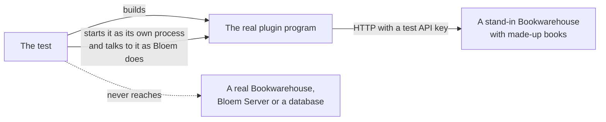

# How the plugin is tested

This page walks through what the tests do, what they prove, what they leave to a
check on a real server, and how to run them.

## What the tests do

The main tests run the **real plugin program**, not a copy of its code inside the
test. They start it the way Bloem Server does and talk to it over the same plugin
connection. In place of Bookwarehouse they run a **stand-in**: a small local web
server that answers like Bookwarehouse's API, with made-up books.



1. The test builds the plugin from this repository, or takes a program you name.
2. It checks the program's built-in description, its **manifest**, against the
   program's own fingerprint.
3. It starts the program as its own process and connects to it like Bloem Server.
4. It gives the plugin settings that point at the stand-in, and asks it to list
   folders and books and to read bytes.
5. It checks every answer, and that a refused read sends no bytes at all.

Smaller tests check the parts one at a time: the code that talks to Bookwarehouse,
the listing and reading code, and the verified download cache.

## What they prove, and what they don't

They show that the plugin:

- lists ebooks, folders, audiobooks, authors and series, page by page, without
  missing or repeating a book;
- sends only bytes that match the fingerprint Bloem scanned, and refuses a book that
  changed;
- refuses reads once Bookwarehouse withdraws permission, even from the cache;
- reads audiobook tracks without downloading or keeping them;
- orders ebooks and audiobooks the way Bookwarehouse's source says it accepts them,
  and reports their progress in the envelopes Bloem Server reads.

They don't show how fast a real Bookwarehouse is, how its permissions are set up,
whether a book is really gone, how several servers behave together, or whether Bloem
creates a library, shows a reader or accepts the plugin. The made-up books are not
real EPUB, PDF or audio files: the tests check moving and checking bytes, not
opening books or playing sound. Those checks belong on a real server.

## Running the tests

1. Use Go 1.26 or newer. The race tests also need a working C compiler.
2. Run:

   ```sh
   make test
   make test-race
   ```

3. To test a program you already built, give its full path:

   ```sh
   BOOKWAREHOUSE_TEST_BINARY="$PWD/dist/linux-amd64/bloem-plugin-bookwarehouse" \
     go test -mod=readonly -count=1 ./cmd/bloem-plugin-bookwarehouse
   ```

   Run it on a machine that can execute that program.

## Words used in the code

| On this page | In the code |
| --- | --- |
| The main tests | `TestExecutablePlugin` (`cmd/bloem-plugin-bookwarehouse/main_test.go`) and `TestExecutableAudioPlugin` (`audio_test.go`) |
| The stand-in Bookwarehouse | `newBookwarehouseFixture` and the `httptest` servers in those files |
| Starting the plugin like Bloem | the SDK's `runtime.HandshakeConfig()` and `runtime.DefaultPluginSet(...)` with go-plugin |
| Smaller tests | `internal/bookwarehouse`, `internal/provider` and `internal/verifiedcache` test files |
| A program you name | `BOOKWAREHOUSE_TEST_BINARY` |
| Race tests | `make test-race`, which sets `BOOKWAREHOUSE_TEST_RACE=1` |
| The checks on every change | `.github/workflows/ci.yml` |

## For developers

The executable integration suite builds `cmd/bloem-plugin-bookwarehouse`, starts it
using the published SDK `runtime.HandshakeConfig()` and
`runtime.DefaultPluginSet(...)`, and dispenses a real SDK client over go-plugin's
gRPC connection. It does not substitute an in-process gRPC server for the plugin.
The process starts with only `PATH`, and a private `HOME` and `TMPDIR`.

```sh
make test
make test-race
```

The race target instruments both the Go test process and the plugin subprocess; it
requires a working C compiler. Release builds always use `CGO_ENABLED=0`. A race
report from the subprocess fails the test. CI runs `make test-race`,
`GOWORK=off go vet ./...` and `make build` with Go 1.27.4 on every push and pull
request.

The executable tests check:

- Manifest CLI SHA-256 against the executable, the plugin ID, the version,
  `silo_api_version` `v1`, exactly the `request_router.v1` capabilities `ebooks`
  (`book`) and `audiobooks` (`audiobook`), secret `api_key` and `request_api_key`
  field metadata, and agreement with `Runtime.GetManifest`.
- The request router in the same process: refusing requests before configuration,
  testing the ebook connection with the installation's own address and key, and
  refusing audiobook requests on an ebook installation.
- `Runtime.Configure` delivering the connection Struct to the provider without a
  RuntimeHost broker.
- Real HTTP routing through a reverse-proxy prefix, `X-API-Key`, format filters,
  bounded backend page limits, and `updated_at` ascending sort.
- Nested folder browsing (`directories_only`) and directory `Stat` without an
  expected revision, then the scoped file inventory of the selected folder.
- `Describe`, bounded advancing `List` cursors, directory/file `Stat`, stable
  identities and SHA-256 revisions for EPUB/PDF.
- Full and partial `Read` bytes, consecutive absolute offsets, 128 KiB chunk bounds,
  EOF and an OK final stream status.
- Immutable cached bytes surviving a corrupt replacement response while a one-byte
  download authorization probe (`Range: bytes=0-0`) is still made: one download and
  one probe per cached read.
- Metadata denial, download denial before and after warming the cache, corrupt
  initial download, and changed pinned metadata failing without any data chunks, and
  RPC errors that never contain the API key.
- For audiobooks: the manifest's `content` selector, the distinct `audio-root`
  identity, a track listing that makes no stream request and issues `bwaudio-v1:`
  revisions, a read that requests exactly its span, revoked stream access as
  `PermissionDenied`, and a fresh plugin process that keeps a track's revision
  without opening the track and refuses, before any stream request, a revision
  Bookwarehouse no longer describes.

The HTTP fixture mirrors the Bookwarehouse API:
`GET /api/v1/books` with a `books` array and `pagination` envelope,
`GET /api/v1/books/{id}` with a direct book object, full HTTP-200
`GET /api/v1/books/{id}/download`, a `206` answer to the one-byte authorization
probe, and `GET /api/v1/books/folders` for nested folders. Files are deliberately
synthetic bytes; the suite tests storage transport and integrity, not EPUB/PDF
rendering.

The internal provider, HTTP client and verified-cache suites also cover:

- Nested ebook directory browsing, paginated siblings and directory existence.
- Scoped inventories preserving flat file identities and immutable reads.
- Rejected traversal paths, ignored folder filters, malformed directory data, changed
  continuation scopes, missing directories and permission denial.
- Real plugin-process directory-only calls through a reverse-proxy prefix, unpinned
  directory `Stat` and a selected nested-root inventory.
- Single m4b and ordered mp3 tracks whose provider fingerprints are repeated.
- Collection spellings on separate provider pages listed as separate directories
  with the same books; 25,000-row listings read only the pages they return;
  continuations resuming after the last spelling when rows are added or removed
  before it; one-collection lookups for listing and `Stat`.
- Directory browsing without stream hydration, with continuations bound to their
  browsing intent.
- Track listings that open no audio; revisions that follow the provider's sampled
  hash, size and path, and stay put when only unsampled bytes change.
- Reads that request exactly their span; stale revisions refused before any bytes are
  requested, across a process restart too; revoked, missing and resized files;
  chunking, cancellation and send failures.
- Invalid file ownership and chapter associations, stream redirects and bounded range
  replies that do not match the request.
- Embedded chapters of a one-file book, a 1,194-chapter one-file book, chapters that
  do not fit their track, and a track whose chapters outgrow a page.
- Ebook defaults, configuration token namespace, read/hash and cover tests.
- Keyset listing that visits every book once across catalog changes, advisory totals,
  unpublishable rows, the reply-size budget, replies before the deadline, change
  tokens with deletions, the full-scan anchor, and version-1 tokens and version-3 cursors.
- The verified cache: private files, mismatched, truncated and oversized downloads,
  least-recently-used eviction, the 128-entry limit, four concurrent downloads,
  downloads that outlive their caller, resumed and restarted transfers, stalled
  requests, the download time limit (shortened in tests), and close while reading.

The request router suite (`internal/requests`) runs against a stand-in Bookwarehouse
that answers with the request shapes of Bookwarehouse's source: monitoring `202`
`request_id`, `409` `book_exists`, the `500` for an already completed request, the
monitoring status set and a cancellation written as `failed` with
`Cancelled by user`; the AudiobookBay search array, the torrent list and record, the
torrent statuses through `completed` with an `audiobook_id`, the `403`
`missing permission: books.create` for a key without the Curator role, the `400` for
an empty add, and the `500` for a repeated info hash. It covers:

- The ebook router moved from `bloem.requests.bookwarehouse`, with its tests: the
  byte-exact `bwh1.` receipt, look-first submission, recovery without a second post,
  large catalogs, PDF from the connection or the installation, redirects and secrets.
- Audiobook search, choice, add and status through completion; adoption on a later
  pass; excluded, approved, failed and cancelled releases; a dropped add that is
  found again; a changed `base_url`; the host's recovery receipt; and plain refusals
  of a key without the Curator role from Fulfill, Validate, ListConfigOptions and
  TestConnection, which create nothing.
- Every `abr1.` and `abd1.` envelope decoded the way Bloem Server decodes it,
  rejecting unknown fields, with the two added fields `torrent_id` and
  `audiobook_id`.
- The release choice as a table: title, sequel, subtitle, author, narrator, format,
  seeders, sizes and outliers, collections, missing magnets and skipped releases.
- Refusal of the content kind an installation does not serve, from all five calls.

Audiobook HTTP fixtures follow the actual top-level `audiobooks`, `page`, `limit` and
`total` envelope, including `null` empty arrays, direct detail objects and explicit
`stream?file_id=...` requests. Bloem Server owns book publication: it publishes a
track from listed metadata that has a codec and a duration of at least one second,
and probes any other track once. Synthetic audio bytes test storage integrity and
transport, not decoding or the host presentation.

To test a particular already-built artifact, give the integration suite its absolute
path with `BOOKWAREHOUSE_TEST_BINARY`, as shown above. Use a machine that can execute
that artifact. When supplying an external artifact, its instrumentation is determined
by how it was built; the race test environment cannot add race instrumentation
afterward.

These tests make no requests to a deployed Bookwarehouse, Bloem Server, a database or
object store. They do not prove production throughput, live permission
configuration, authoritative catalog absence, cross-node behavior, library creation,
EPUB/PDF reader integration or host admission. Those remain deployment-specific
acceptance work. Cross-compilation alone is not native execution evidence.

Related pages:

- [Bookwarehouse plugin reference](reference.md).
- [Installing Bookwarehouse by hand](native-installation.md).
